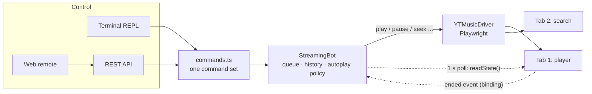

# Streaming-Bot

A personal YouTube Music player bot built on [Playwright](https://playwright.dev). It opens YouTube Music in a real
browser window and lets you control it from the terminal, a REST API, or a web remote on your phone. You can search,
play, keep a queue, skip, seek and set the volume, and it hands over to YouTube Music's own autoplay when your queue
runs out.

```
$ npm start -- "daft punk get lucky"
07:12:03 INFO  YouTube Music is open.
07:12:03 INFO  Web remote: http://127.0.0.1:8765/  ·  API: http://127.0.0.1:8765/api/status
Type "help" for commands, "quit" to exit.
ytm> search instant crush
 1. Instant Crush — Daft Punk (Random Access Memories, 5:37)  [Song]
 2. …
Use "play #N" or "add #N".
ytm> add #1
Queued #1: Instant Crush — Daft Punk (Random Access Memories, 5:37)
ytm> np
▶ Get Lucky — Daft Punk (Random Access Memories, 6:09)  1:02 / 6:09  vol 60
Queue: 1 track · autoplay on
```

It's meant for **your own listening**: one browser, one profile, one person in control. It deliberately has no
multi-account, proxy, fingerprint-spoofing, CAPTCHA-solving or "play N times" features. That would be stream
manipulation, which YouTube's terms forbid and which takes royalties from artists who get real plays. If Google
shows a CAPTCHA or consent page, the bot stops and asks you to deal with it in the window.

## Quick start

Requires Node.js 22.18 or newer, which runs the TypeScript sources directly with no build step.

```sh
npm install
npx playwright install chromium   # once; or use your installed Chrome with --channel chrome
npm start                          # opens YouTube Music and a ytm> prompt
```

Optionally sign in so you get your library, recommendations and Premium (no ads):

```sh
npm run login        # sign in in the window that opens, then close it
```

The session is kept in `~/.ytm-bot/profile`, so you only do this once. Google sometimes refuses sign-in from
automated browsers. If it does, `--channel chrome` may help, and everything also works signed out.

## Controlling it

### Terminal

| Command | What it does |
| --- | --- |
| `play <query \| url \| #N>` | Play now (no argument: resume) |
| `add <…>` / `playnext <…>` | Add to the end of the queue / right after the current track |
| `search <query>` | List results; use `#N` with `play` / `add` |
| `next`, `prev` | Skip; restart or go back |
| `pause`, `resume`, `toggle`, `stop` | |
| `volume [0-100 \| +N \| -N]` | |
| `seek <90 \| 1:30 \| +10 \| -10>` | |
| `status` (`np`) | What's playing |
| `queue`, `remove <N>`, `move <from> <to>`, `clear` | Manage the queue |
| `autoplay [on \| off]` | Keep going with YouTube Music's picks when the queue ends |

Anything you can play can be a search query, a `music.youtube.com` / `youtube.com` / `youtu.be` link (videos or
playlists), `id:<videoId>`, or `#N` from your last search. Things given on the command line are queued at startup:
`npm start -- "song one" "https://music.youtube.com/watch?v=…"`.

### Web remote

Open `http://127.0.0.1:8765/` for a now-playing card, transport controls, volume, search and the queue. It works in
light and dark mode and at phone width. To use it from another device, see [Security](#security).

### REST API

```sh
curl localhost:8765/api/status                       # current track, player state, queue
curl 'localhost:8765/api/search?q=daft+punk'         # results, without touching playback
curl -X POST localhost:8765/api/command \
     -H 'Content-Type: application/json' \
     -d '{"command": "add daft punk instant crush"}'  # any terminal command
```

`/api/command` replies `{"ok": true, "message": "…", "data": …}`, or status 422 with `"ok": false` and a
human-readable message when the command fails. This makes it easy to drive from a chat bot, a Stream Deck,
or home automation.

## Configuration

Every option can be a flag, and most also an environment variable. `npm start -- --help` has the full list.

| Flag | Env | Default |
| --- | --- | --- |
| `--profile <dir>` | `YTM_BOT_PROFILE` | `~/.ytm-bot/profile` |
| `--channel <chrome\|msedge>` | `YTM_BOT_CHANNEL` | Playwright's Chromium |
| `--port <n>` / `--host <addr>` | `YTM_BOT_PORT` / `YTM_BOT_HOST` | `8765` / `127.0.0.1` |
| `--api-token <token>` | `YTM_BOT_API_TOKEN` | none |
| `--no-server`, `--no-repl`, `--no-autoplay` | | |
| `--volume <0-100>` | | YouTube Music's own setting |
| `--gate-timeout <sec>` | | `300` |
| `--log-level <level>` | `YTM_BOT_LOG_LEVEL` | `info` |

### Running on a machine without a display

YouTube Music refuses headless browsers, and you want to hear it anyway, so run a normal window inside a virtual
display. Audio goes to whatever PulseAudio/ALSA output the machine has:

```sh
xvfb-run -a npm start -- --no-repl --host 0.0.0.0 --api-token "$(openssl rand -hex 16)"
```

Then use the web remote from your phone at `http://<machine>:8765/#token=<token>`. To sign in on such a machine, run
`npm run login` once over `ssh -X` or a VNC session. Copying a profile from another computer usually doesn't
work, because Chromium encrypts cookies with that computer's keychain.

### Security

The API controls a browser that may be signed in to your Google account, so:

- It listens on `127.0.0.1` only, unless you pass `--host`. If you open it up, set `--api-token`; the bot warns if you don't.
- Web pages you visit can send requests to localhost, so `POST`s must be JSON (browsers can't send that cross-site
  without the server's consent), cross-origin requests are refused, and the `Host` header is checked to stop DNS rebinding.
- The web remote takes the token from the URL fragment (`#token=…`), which browsers don't send to servers, and keeps it in session storage.

## How it works



| Module | Responsibility |
| --- | --- |
| `src/ytmusic/selectors.ts` | Every CSS selector and URL shape, plus detecting CAPTCHA/consent/sign-in pages. **When YouTube Music changes its markup, this is the file to fix.** |
| `src/ytmusic/driver.ts` | Page-level Playwright work: navigating, searching, reading player state, pressing buttons. No policy. |
| `src/bot.ts` | The queue, history, autoplay decisions and track-end handling. Every playback change goes through one mutex, so commands from the terminal, API and page events can't interleave. |
| `src/commands.ts` | The command set shared by the terminal and `/api/command`. |
| `src/server.ts`, `src/web/index.html` | REST API and the single-file web remote. |
| `src/ytmusic/parse.ts` | Pure parsing: URLs, IDs, durations, result subtitles. |

Design decisions worth knowing:

- **Standards first, private APIs last.** Playback state comes from the `<video>` element and
  `navigator.mediaSession` (title, artist, album, artwork), which are web standards and rarely change. Controls press
  the same player-bar buttons you would, falling back to the `<video>` element and only then to YouTube's player
  object. A markup change then usually degrades one feature rather than breaking all of them.
- **Two tabs.** Searching navigates a second tab, so looking for the next song never interrupts the current one.
- **Your queue wins, then YouTube Music's.** When a track ends and you've queued something, the bot plays it. If not,
  and autoplay is on, YouTube Music's own Up Next or radio carries on and the bot follows along. If autoplay is off,
  it stops.
- **Two ways to notice a track ending.** An `ended` listener injected into the page reports back through a Playwright
  binding, which is fast. A 1-second poll catches anything missed and notices when you change songs in the window
  yourself. Ads are ignored: an ad's `ended` is recognised by the player's `ad-showing` class or by a length that
  doesn't match the track.
- **Humans handle gates.** CAPTCHA, cookie-consent and sign-in pages are detected by URL. With a visible window the
  bot asks you to finish them there and waits; otherwise it fails with a clear `GateError`.
- **No build step.** Node 22.18+ strips TypeScript types natively; `tsc` is only used for type-checking.

## Development

```sh
npm test            # unit + integration tests (headless Chromium, no network needed)
npm run typecheck
```

The integration tests drive real Chromium against `test/integration/fake-ytmusic.ts`. This is a local imitation of
the parts of YouTube Music the bot depends on: its search markup, the player bar, `#movie_player`, mediaSession,
SPA-style track changes, autoplay, preroll ads, playlists and the `/sorry` CAPTCHA page. That keeps the suite fast
and deterministic and means it never sends traffic to Google. If you change `selectors.ts` to match a new YouTube
Music layout, update the fake to match.

## Limitations

- YouTube Music has no public API, so this depends on its web page. Expect to update `selectors.ts` occasionally.
- Signed out, you get ads (the bot reports `status: ad` and waits them out) and regional catalogue limits.
- After long unattended playback YouTube Music may ask "Still listening?". Playback stays paused until you answer in
  the window or send `resume`.
